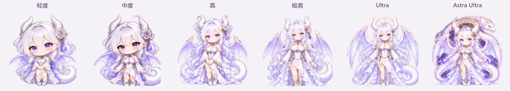
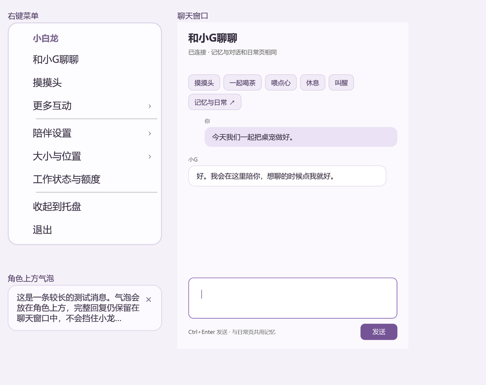

# Codex 小白龙桌宠

随模型和思考强度变换形态，陪你工作、聊天和休息的 Windows 桌面伙伴。

**[下载 v0.8.1 Windows 运行包](https://github.com/liuliuliu-a11y/codex-dragon-pet/releases/download/v0.8.1/codex-white-dragon-0.8.1-win-x64.zip)** · [更新说明与全部附件](https://github.com/liuliuliu-a11y/codex-dragon-pet/releases/tag/v0.8.1)



## 六档形态，跟随正在执行的模型

保留银白长发、紫瞳、龙角、白玫瑰和淡紫翼尾。从小小的白龙，到展翼形态，再到身后盘绕神龙的 Astra 形态，外观会随模型与思考强度变化。

| 当前轮设置 | 对应形态 |
| --- | --- |
| `low`，或 `minimal` / `none` | 小白龙 |
| `medium` | 中度形态 |
| `high` | 高强度形态 |
| `xhigh` | 极高强度形态 |
| `ultra` / `max` | 展翼形态 |
| 模型名包含 `astra`，且为 `ultra` / `max` | 神龙形态 |

模型和强度在 Codex 中选择，小白龙根据下一轮实际执行记录更新外观。未提供强度时使用基础形态；其他模型按同一套强度映射显示。桌宠可跟随最近活跃的本机聊天，也沿用已有的固定聊天设置。


## 动作连贯，互动有起势和收势

待机、摸头、拍拍身体、喝茶、吃点心、走路、被提起、落地、睡眠、醒来和抱电脑工作，共用六套角色素材与 33 个动作播放段。动作变化区间按约 30 帧/秒补充中间姿态；工作、睡眠和提起后的保持姿态有手部、呼吸、发尾和尾巴的小幅连续动作。

播放按实际经过时间取帧，图片解码在后台完成。动作与形态切换带短暂过渡；新动作会取消旧回调，减少突然跳姿、迟到动作覆盖和长时间停在一张图上的情况。动画采用二维素材与运动插值，局部遮挡处仍可能出现轻微变形。

[观看 25 秒动作预览](https://github.com/liuliuliu-a11y/codex-dragon-pet/releases/download/v0.8.1/white-dragon-preview-0.8.1.mp4)。预览由实际 WPF 程序渲染帧合成。

## 菜单更短，气泡更轻，拖动更直接

- 右键菜单保留八个常用入口，更多互动、陪伴设置、大小与位置放进子菜单，文字和选中状态更清楚。
- 消息气泡放在角色上方，可关闭、会自动收起。长回复简短显示，完整内容保留在聊天窗。
- 按住角色或底部状态条移动即可拖动；保留最初的鼠标位移，松手后落地。单击角色继续互动，单击状态条查看工作信息。
- 拖动时收到完成事件，会先落地再庆祝，收尾动作和提醒各执行一次。



## 工作状态与可选聊天

工作状态、公开进展、额度和本轮结束提醒继续保留。完成确认会等待完整的本机记录与短暂稳定期，续接任务会撤销待确认提醒。额度显示账户窗口的已用比例和重置信息；缺失或过期数据按实际状态显示。

可选的小G联动增加原生聊天窗、回复表情、互动记录、记忆与养成入口，以及待审提案和未读结果提示。这些能力需要另外运行兼容的本机小G服务，使用固定回环地址 `127.0.0.1:8766`。运行包提供客户端和协议适配；基础桌宠、形态和 Codex 工作联动可独立使用。详见 [本机小G连接说明](docs/LOCAL-COMPANION.md)。

## 下载、运行和更新

适用于 **Windows 10/11 64 位**。运行包自带 .NET 8，使用桌宠无需安装 Python、Node.js 或 SDK。

1. 下载上方 ZIP，完整解压到长期保留的位置。
2. 首次使用双击 `start.cmd`。
3. 更新旧版时解压到一个新文件夹，双击 `update.cmd`。更新程序先备份再替换文件，保留个人设置、额外文件和已有的 Codex 自动联动入口。

`start-with-codex.cmd` 可同时打开 Codex 和小白龙。当前电脑需安装并登录 Codex，才能读取本机工作状态与额度。运行包为 ZIP，源码下载包用于开发者构建。

| 操作 | 结果 |
| --- | --- |
| 单击角色 | 摸头或身体互动 |
| 按住角色或状态条移动 | 拖动位置 |
| 单击状态条 | 查看工作状态与额度 |
| 右键 → 更多互动 | 喝茶、点心、休息、叫醒和走动 |
| 右键 → 陪伴设置 | 安静模式、主动气泡、回复动作及小G连接 |
| 右键 → 大小与位置 | 调整尺寸、置顶或回到屏幕右下角 |
| 右键 → 收起到托盘 | 暂时收起，从托盘恢复 |

## 数据与验证范围

桌宠读取本机 Codex 的公开状态、进展、模型／强度元数据和明确完成事件。账户额度由已有 Codex 登录连接读取。公开包经过文件清单检查，个人设置、聊天记录、账号文件及本机启动配置均不随包分发。小G聊天通过另行配置的本机服务处理，使用对应后端的账号额度。

六档形态已通过实际桌宠窗口逐档核对，包含快速切换检查。菜单、聊天、气泡、拖动控制、落地和完成提醒有程序回归；物理鼠标拖拽与多屏跨 DPI 操作尚待手工验收。构建和验证方法见 [开发与验证](docs/TESTING.md)。

## 从源码构建

需要 Windows、.NET 8 SDK 和系统 .NET Framework 4.x 编译器。重新烘焙素材时需要 Python、Pillow、numpy 和 OpenCV；运行已编译桌宠时不需要这些依赖。

```powershell
python scripts/Build-SmoothForms.py --sheets assets/white-dragon-forms --output tmp/forms
./scripts/Pack-WhiteDragon.ps1 -OutputDirectory tmp/vpet
./scripts/Build-VPet.ps1 -Dotnet dotnet -AssetDirectory tmp/vpet -SmoothFormsDirectory tmp/forms -OutputDirectory bin -SelfContained -Test
./bin/CodexVPet.exe
```

素材输出目录需为新目录。公开运行包使用 `scripts/Package-VPet.ps1` 生成。六张原始图及约定见 [形态素材说明](assets/white-dragon-forms/README.md)，旧版分层 WPF 实现见 [历史资料](docs/LEGACY-WPF.md)。

## 角色与依赖

白龙图形以本项目既有角色为参考生成，原始图随源码保留。动画宿主使用 [VPet-Simulator.Core](https://github.com/LorisYounger/VPet) 1.1.0.72，运行包附第三方许可文本。依赖见 [DEPENDENCIES](DEPENDENCIES.md)，累计更新见 [CHANGELOG](docs/CHANGELOG.md)。

这是个人桌面伙伴项目，角色与 OpenAI 官方产品没有品牌隶属关系。
